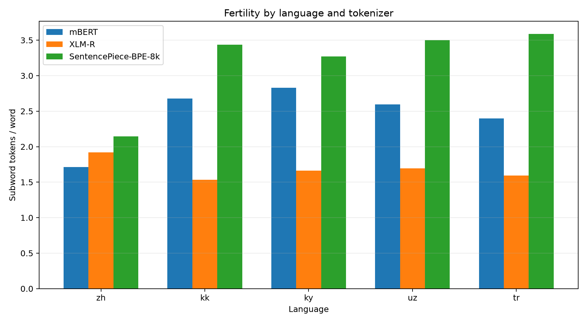

# 第二周实验报告：多语种 Tokenization

**姓名：** ____________________　　**学号：** ____________________

**完成日期：** 2026 年 11 月 18 日

## 一、实验目的

比较 mBERT、XLM-R 和自训练 SentencePiece 对中文、哈萨克语、柯尔克孜语、
乌兹别克语和土耳其语的切分结果，观察黏着语长词被切成多个 subword 的现象。

## 二、数据与工具

| 项目 | 内容 |
|---|---|
| 评估数据 | 五种语言各 500 句，取自 Week 1 语料 |
| 长词案例 | 20 句，其中哈语 7、柯语 7、乌语 6 |
| mBERT | `bert-base-multilingual-cased` tokenizer |
| XLM-R | `xlm-roberta-base` tokenizer |
| SentencePiece | 自训练 BPE，词表大小 8,000 |

只使用 Week 1 的模板语料时，SentencePiece 无法达到 8,000 词表，因此从
OPUS-100 为每种语言补充 2,000 句文本。补充文本仅用于训练词表，不参与评估。

## 三、实验过程

1. 从 Week 1 的每种语言文本中固定间隔抽取 500 句；
2. 整理 20 个含长词形的哈萨克语、柯尔克孜语和乌兹别克语例句；
3. 使用本地 mBERT 和 XLM-R tokenizer 对评估句进行切分；
4. 仅使用补充语料训练 8,000 词 SentencePiece BPE，避免评估数据泄漏；
5. 统计平均 token 数、fertility、序列扩张率和未知率；
6. 输出长词切分结果、10 个解释案例和一张 fertility 柱状图。

指标定义：

- fertility = token 数 ÷ 词数；
- 序列扩张率 = token 数 ÷ 非空白字符数；
- 所有统计均不计特殊标记。

## 四、结果

| 语言 | mBERT fertility | XLM-R fertility | SentencePiece fertility |
|---|---:|---:|---:|
| 中文 | 1.712 | 1.919 | 2.146 |
| 哈萨克语 | 2.680 | 1.532 | 3.438 |
| 柯尔克孜语 | 2.829 | 1.662 | 3.270 |
| 乌兹别克语 | 2.593 | 1.693 | 3.499 |
| 土耳其语 | 2.398 | 1.592 | 3.586 |

在三种黏着语上，mBERT 的切分段数明显多于 XLM-R。长词案例中，
哈萨克语 `тәуелсіздігіміздің` 分别被 mBERT、XLM-R、SentencePiece 切成
10、4、10 段；乌兹别克语 `tadqiqotchilarimizning` 分别被切成 9、4、10 段。
这说明不同 tokenizer 对词根和词缀的划分方式不同。

自训练 SentencePiece 的 fertility 最高。原因是它的训练文本来自 OPUS 通用语料，
而评估文本是课程模板语料，两者句式和词形分布不同；这说明小词表的结果高度依赖
训练数据，不能只看词表大小。

## 五、输出文件

- `outputs/tokenizer_summary.csv`：15 组汇总结果；
- `outputs/long_word_tokenization.csv`：20 个长词切分结果；
- `outputs/case_studies_10.md`：10 个代表性案例；
- `outputs/fertility_comparison.png`：柱状图；
- `outputs/sentencepiece_bpe_8k.model`：8k SentencePiece 模型。
